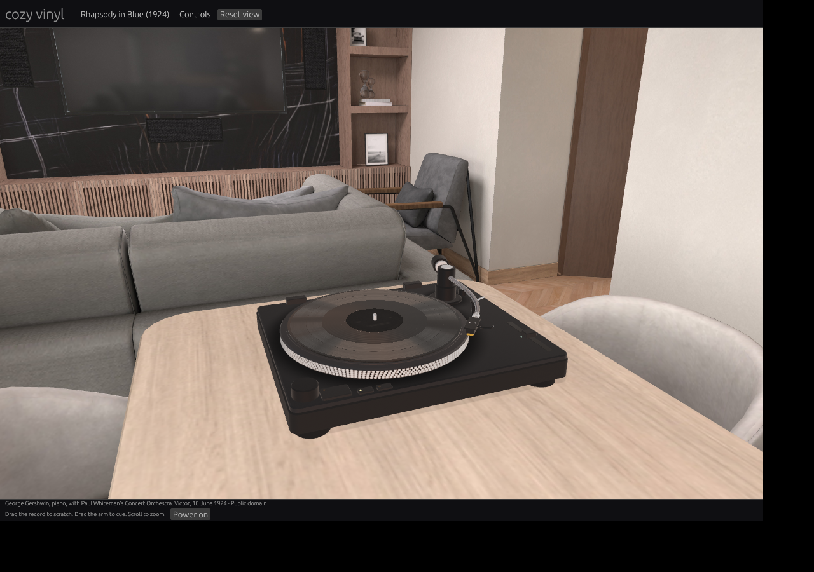

# Cozy Vinyl

A native Rust record player that reads simulated grooves, with an interactive 3D turntable and a cozy listening space.



## Run

```sh
cargo run --release -p vinyl-desktop
```

The desktop app uses native OpenGL rendering and CPAL audio. Drag an audio file into the window to cut a record. Drag the disc to scratch, drag the tonearm to cue, and use the controls to adjust speed, stylus and pressing conditions.

- **Space**: start or stop the motor
- **C**: lift or lower the cue lever
- **B**: knock the plinth
- **Z**: toggle the stylus close-up
- Scroll to zoom; drag empty space to orbit

See [native usage](docs/native.md), [rendering notes](docs/photorealistic-rendering.md), and [system audio / Spotify research](docs/rust-and-system-audio.md).

## Project

- `crates/vinyl-core`: groove cutting, pressing and physical playback simulation
- `crates/vinyl-desktop`: desktop UI, audio devices, record library and rendering
- `assets`: prepared grooves, fonts and scene resources
- `records`: source recordings

The player sits at the dining table inside [Appartement by SrMonteiro](assets/room/README.md), a complete furnished 3D room. Spotify audio routing is research only.

## Credits

Every recording is public domain or freely licensed:

- Gershwin, _Rhapsody in Blue_: George Gershwin, piano, with Paul Whiteman's Concert Orchestra, Victor, 1924 ([LOC](https://www.loc.gov/item/jukebox-70342/))
- Beethoven, _Moonlight Sonata_: Paul Pitman, piano, for Musopen
- Satie, _Gymnopédie No. 1_: Robin Alciatore, piano, for Musopen
- Chopin, _Nocturne Op. 9 No. 2_: Frank Lévy, piano, for Musopen
- Debussy, _Clair de lune_: Laurens Goedhart, piano, 2011
- Grieg, _In the Hall of the Mountain King_: Musopen Symphony
- Tchaikovsky, _1812 Overture_: US Marine Band, live at Wolf Trap, 2019
- Bach, _Toccata and Fugue_: Ashtar Moïra, organ
- Vivaldi, _Summer: Presto_: John Harrison, violin, with the Wichita State University Chamber Players (CC BY-SA 4.0)
- HoliznaCC0, _Summer Air_ (CC0, [Free Music Archive](https://freemusicarchive.org/music/holiznacc0/summer-air-lo-fi/))

Sources for each are linked in [`crates/vinyl-desktop/src/records.rs`](crates/vinyl-desktop/src/records.rs). The _Demo EP_ is synthesised by the player.

## License

Code is distributed under the [MIT license](LICENSE), including the retained copyright notice for derived code. Recordings and scene assets retain their own licenses; see the credits above and the asset directories.
